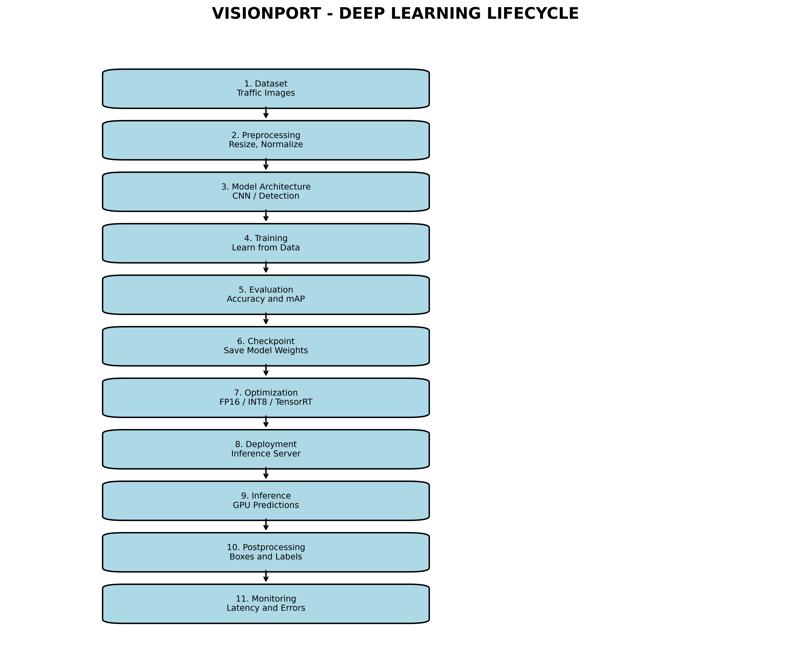
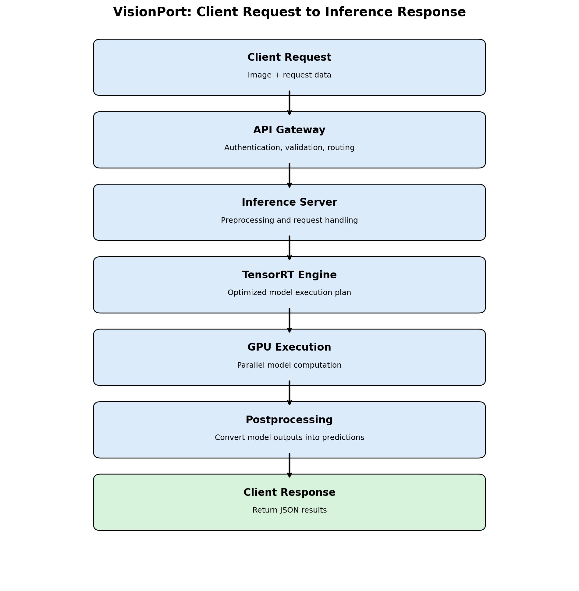

# Skill - 1: VisionPort

## Overview
This project demonstrates the VisionPort deep learning lifecycle
and inference pipeline using Google Colab.

## Experiment 1: VisionPort Lifecycle
The lifecycle covers:
- Dataset preparation
- Preprocessing
- Model architecture
- Training and evaluation
- Checkpoint creation
- Model optimization
- Deployment and monitoring

[View Lifecycle PDF](VisionPort_Lifecycle.pdf)

## Experiment 2: Inference Pipeline
This experiment explains the complete request-response path:
- Client Request
- API Gateway
- Inference Server
- TensorRT Engine
- GPU Execution
- Postprocessing
- Client Response

[View Inference PDF](VisionPort_Inference_Architecture.pdf)

## Dependency Analysis
Each component depends on the previous stages.
The API Gateway routes requests, the inference server
prepares inputs, TensorRT optimizes execution, and the GPU
performs computations. Postprocessing formats the predictions
before returning the response to the client.

## Tools Used
- Python
- Google Colab
- PyTorch (environment inspection)
- Matplotlib
- TensorRT concepts
- GitHub

## Note
The inference pipeline in this experiment is a simulation.
No actual trained TensorRT model was deployed.

## Conclusion
The experiments provide an understanding of the deep learning
lifecycle and the relationship between inference components.
